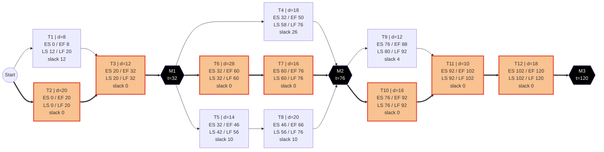
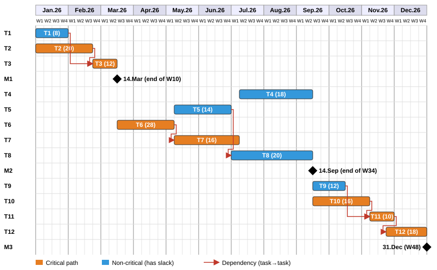

# BLG 411E – Software Engineering · Sample Exam 2026 · Tam Çözüm

> Her bölümün başında sorunun orijinal metni (📄 SORU kutusu) yer alır. Açıklamalar Türkçe, sınava yazılacak cevaplar (cevap anahtarı kısımları) İngilizcedir.
> Gantt görseli: [`gantt.svg`](gantt.svg) / [`gantt.png`](gantt.png)

---

## Soru 1 – Proje Planlama (Effort, PERT, Gantt)

<div class="q">

**📄 SORU (orijinal metin):**

**1.** Imagine you have a team of four (cross-functional) developers working on a project which starts on January 2026 and expected to finish at the end of December 2026. After a round of initial planning following tasks (T) and milestones (M) have been identified:

| Task ID | Estimated Effort (man.week) | Prerequisite | Deadline (end of month) |
|---|---|---|---|
| T1 | 8 | - | - |
| T2 | 20 | - | - |
| T3 | 12 | T1, T2 | - |
| M1 | - | T3 | February 2026 |
| T4 | 18 | M1 | - |
| T5 | 14 | M1 | - |
| T6 | 28 | M1 | - |
| T7 | 16 | T6 | - |
| T8 | 20 | T5 | - |
| M2 | - | T4, T7, T8 | August 2026 |
| T9 | 12 | M2 | - |
| T10 | 16 | M2 | - |
| T11 | 10 | T9, T10 | - |
| T12 | 18 | T11 | - |
| M3 | - | T12 | December 2026 |

Please assume each month is exactly 4 weeks long; **a developer can work for at most one task each week**; and the effort spent by each member do not fluctuate throughout the project.

</div>


### 0. Temel veriler ve varsayımlar

| Büyüklük | Değer |
|---|---|
| Geliştirici sayısı | 4 |
| 1 ay | 4 hafta |
| 1 yıl | 12 × 4 = **48 hafta** |
| Ekip kapasitesi / hafta | 4 dev × 1 = **4 man.week** |
| Ekip kapasitesi / ay | 4 dev × 4 hafta = **16 man.week** |
| Ekip kapasitesi / yıl | 16 × 12 = **192 man.week** |
| Kural | Bir geliştirici bir haftada **en fazla 1 task**'ta çalışır (haftayı bölemez). Bir task'ta aynı anda birden çok dev çalışabilir (cross-functional). |

Görevleri milestone'lara göre **3 faza** ayırıyoruz (milestone'lar bir "bariyer": M1 bitmeden T4/T5/T6, M2 bitmeden T9/T10 başlayamaz):

| Faz | Görevler | Toplam Effort | Deadline | Deadline'a kadar kapasite (kümülatif) |
|---|---|---|---|---|
| Faz 1 (→M1) | T1(8) + T2(20) + T3(12) | **40** | Şubat sonu (2 ay = 8 hafta) | 2 × 16 = **32** |
| Faz 2 (→M2) | T4(18) + T5(14) + T6(28) + T7(16) + T8(20) | **96** | Ağustos sonu (8 ay = 32 hafta) | 8 × 16 = **128** |
| Faz 3 (→M3) | T9(12) + T10(16) + T11(10) + T12(18) | **56** | Aralık sonu (12 ay = 48 hafta) | 12 × 16 = **192** |
| **Toplam** | | **192** | | **192** |

---

### a) Milestone deadline'ları tutuyor mu?

<div class="q">

**📄 SORU (orijinal metin):**

a) Calculate if the project is possible to be completed within the given deadline constraints for milestones.

</div>


**M1 (Şubat sonu, hafta 8):**
- Gereken effort: 8 + 20 + 12 = **40 man.week**
- Mevcut kapasite: 4 dev × 8 hafta = **32 man.week**
- 40 > 32 ⇒ **M1 tutturulamaz.**
- Zaman olarak da: T1 ve T2 paralel → (8+20)/4 = 7 hafta; T3 bunlara bağlı → 12/4 = 3 hafta ⇒ **en erken 10. hafta sonu** (Mart 2. hafta). Deadline 8. hafta → **2 hafta gecikme**.

**M2 (Ağustos sonu, hafta 32):**
- Kümülatif gereken: 40 + 96 = **136 man.week**
- Kümülatif kapasite: 4 × 32 = **128 man.week**
- 136 > 128 ⇒ **M2 de tutturulamaz.** En erken: 136 / 4 = **34. hafta sonu** (Eylül 2. hafta) → 2 hafta gecikme.

**M3 (Aralık sonu, hafta 48):**
- Kümülatif gereken: 40 + 96 + 56 = **192**; kapasite: 4 × 48 = **192** ⇒ kapasite olarak **tam sınırda** (sıfır boşluk).

> **Answer (a):** *No.* M1 needs 40 man.week but only 32 are available until end of Feb (needs at least 10 weeks → earliest mid-March). M2 needs cumulative 136 man.week but only 128 are available until end of Aug (earliest end of week 34 → mid-Sep). Therefore the milestone deadlines **cannot** be met. M3 is exactly at the capacity limit (192 = 192).

---

### b) Tüm proje 1 yılda bitebilir mi?

<div class="q">

**📄 SORU (orijinal metin):**

b) Calculate if the project is possible to be completed within the given deadline constraints for the whole project (one year).

</div>


- Toplam effort = **192 man.week**
- Toplam kapasite = 4 dev × 48 hafta = **192 man.week**
- 192 ≤ 192 ⇒ **Evet, mümkün — ama sıfır boşlukla (%100 utilization).** Hiçbir geliştirici hiçbir hafta boş kalamaz; tek bir hafta kayma projeyi geciktirir. Milestone'ların (M1, M2) ileri kaydırılması gerekir (bkz. d).

Faz bazında minimum süreler (kontrol):

| Faz | Effort | Min. süre (effort/4) | Hafta aralığı |
|---|---|---|---|
| Faz 1 | 40 | 10 hafta | 1 – 10 |
| Faz 2 | 96 | 24 hafta | 11 – 34 |
| Faz 3 | 56 | 14 hafta | 35 – 48 |
| **Toplam** | 192 | **48 hafta** | ✔ 31 Aralık |

> **Answer (b):** Total effort = 8+20+12+18+14+28+16+20+12+16+10+18 = **192 man.week**. Capacity = 4 developers × 12 months × 4 weeks = **192 man.week**. Since 192 ≤ 192 the project **can** be finished within one year, but only with **100 % utilization (no slack at all)** and only if M1 and M2 are shifted (M1 → end of week 10, M2 → end of week 34).

> ⚠️ **İnce nokta (hoca sorarsa / bonus olarak yazılabilir):** "Bir dev bir haftada sadece bir task" kuralı **kesin** uygulanırsa T11 (10 man.week) ve T12 (18 man.week) 4'ün katı değildir. T11'in son haftasında sadece 2 dev çalışabilir; diğer 2 dev T12'ye (T11'e bağlı) geçemez ve başka iş de kalmamıştır ⇒ T11 ve T12'de 2'şer man.week zorunlu boşluk ⇒ Faz 3 = 15 hafta, proje = **49 hafta**. Aşağıdaki planda bu durum, T12'nin T11'den bağımsız kısmının (ör. hazırlık/test ortamı kurulumu) T11'in son haftasında 2 dev tarafından başlatılmasıyla (Nov W4'te T11:2 + T12:2) çözülmüştür. Sınavda beklenen ana cevap kapasite hesabıdır (**192 = 192 → mümkün**); bu notu bir cümle ile eklemek tam puan için güvenli bir yaklaşımdır.

---

### c) PERT Chart ve Critical Path

<div class="q">

**📄 SORU (orijinal metin):**

c) Draw the PERT chart for this project and identify the critical path.

</div>


PERT'te süre olarak her task'ın effort'u (man.week) kullanılır (1 kişi çalışıyormuş gibi). Forward pass (ES/EF) ve backward pass (LS/LF):

| Task | Süre (effort) | Prerequisite | ES | EF | LS | LF | Slack (LS−ES) | Critical? |
|---|---|---|---|---|---|---|---|---|
| T1 | 8 | – | 0 | 8 | 12 | 20 | **12** | |
| T2 | 20 | – | 0 | 20 | 0 | 20 | 0 | ✔ |
| T3 | 12 | T1, T2 | 20 | 32 | 20 | 32 | 0 | ✔ |
| **M1** | 0 | T3 | 32 | 32 | 32 | 32 | 0 | ✔ |
| T4 | 18 | M1 | 32 | 50 | 58 | 76 | **26** | |
| T5 | 14 | M1 | 32 | 46 | 42 | 56 | **10** | |
| T6 | 28 | M1 | 32 | 60 | 32 | 60 | 0 | ✔ |
| T7 | 16 | T6 | 60 | 76 | 60 | 76 | 0 | ✔ |
| T8 | 20 | T5 | 46 | 66 | 56 | 76 | **10** | |
| **M2** | 0 | T4, T7, T8 | 76 | 76 | 76 | 76 | 0 | ✔ |
| T9 | 12 | M2 | 76 | 88 | 80 | 92 | **4** | |
| T10 | 16 | M2 | 76 | 92 | 76 | 92 | 0 | ✔ |
| T11 | 10 | T9, T10 | 92 | 102 | 92 | 102 | 0 | ✔ |
| T12 | 18 | T11 | 102 | 120 | 102 | 120 | 0 | ✔ |
| **M3** | 0 | T12 | 120 | 120 | 120 | 120 | 0 | ✔ |

Tüm yolların uzunlukları:

| Yol | Uzunluk (man.week) |
|---|---|
| **T2 → T3 → M1 → T6 → T7 → M2 → T10 → T11 → T12 → M3** | **20+12+28+16+16+10+18 = 120** ← en uzun |
| T1 → T3 → M1 → T6 → T7 → M2 → T10 → T11 → T12 | 8+12+28+16+16+10+18 = 108 |
| T2 → T3 → M1 → T5 → T8 → M2 → T10 → T11 → T12 | 20+12+14+20+16+10+18 = 110 |
| T2 → T3 → M1 → T4 → M2 → T10 → T11 → T12 | 20+12+18+16+10+18 = 94 |
| T2 → T3 → M1 → T6 → T7 → M2 → T9 → T11 → T12 | 20+12+28+16+12+10+18 = 116 |

> **Critical path:** **Start → T2 → T3 → M1 → T6 → T7 → M2 → T10 → T11 → T12 → M3** (120 man.week). Slack'i olan görevler: T1 (12), T4 (26), T5 ve T8 (10), T9 (4).
>
> (Süreleri 4 dev ile "hafta" cinsinden alırsanız (effort/4) critical path değişmez: 5+3+7+4+4+2.5+4.5 = 30 hafta.)

**PERT diyagramı** (kutu formatı: `Task | ES – EF | süre | LS – LF | slack`; kalın/turuncu kenarlar critical path):



Kâğıtta çizerken (ASCII karşılığı):

```
 Faz 1 – Faz 2:
            ┌──T1(8)──┐
 Start ─────┤         ├──► T3(12) ──► ◆M1 ──┬──► T4(18) ─────────────────┐
            └══T2(20)═┘                     ├──► T5(14) ──► T8(20) ──────┤
                                            └══► T6(28) ══► T7(16) ══════┴══► ◆M2

 Faz 3:
          ┌──► T9(12) ──┐
 ◆M2 ─────┤             ├══► T11(10) ══► T12(18) ══► ◆M3
          └══► T10(16) ═┘

 ═══ : critical path
 (T2 → T3 → M1 → T6 → T7 → M2 → T10 → T11 → T12 → M3)
```

---

### d) Gantt Chart (M1 ve M2 en erken tarihe kaydırılmış)

<div class="q">

**📄 SORU (orijinal metin):**

d) By shifting the milestones M2 and M3 to the earliest deadlines possibles, provide a gantt chart that can be used to complete this project on time. Please do not draw dependencies towards/from milestones; draw the other dependencies. Please also fill in the total man.week spend in each cell, indicate milestones as specific dates. Keep the idle cells empty.

</div>


> Not: Soru metninde "M2 and M3" yazıyor, ancak şablonda M3 zaten **31.Dec** olarak sabit verilmiş ve deadline'ı tutmayan milestone'lar **M1 ve M2**. Dolayısıyla kaydırılanlar M1 ve M2'dir; M3 31 Aralık'ta kalır.

**Kaydırılmış milestone tarihleri:**

| Milestone | Orijinal deadline | Yeni (en erken mümkün) tarih |
|---|---|---|
| M1 | Şubat 2026 sonu (W8) | **Hafta 10 sonu = Mart W2 sonu ≈ 14 Mart 2026** |
| M2 | Ağustos 2026 sonu (W32) | **Hafta 34 sonu = Eylül W2 sonu ≈ 14 Eylül 2026** |
| M3 | Aralık 2026 sonu (W48) | **31 Aralık 2026** (değişmedi) |

**Planlama mantığı:**
1. **Faz 1 (W1–W10):** T1 ile T2 paralel (Dev1–2 Ocak'ta T1, Dev3–4 T2; Şubat W1–W3'te 4 dev T2). T3, T1 ve T2 bittikten sonra 4 dev ile 3 hafta (W8–W10).
2. **Faz 2 (W11–W34):** En uzun zincir T6→T7 (44) önce başlatılır: T6 4 dev ile 7 hafta (W11–W17). Sonra Dev1–2 T7 (W18–W25), Dev3–4 T5 (W18–W24) → T8 (W25–W34). T4'ün slack'i büyük olduğu için en sona, boşlukları doldurmak için konur: Dev1–2 W26–W34.
3. **Faz 3 (W35–W48):** T9 (Dev1–3, W35–W38) ve T10 (Dev4 W35–W41 + Dev1–3 W39–W41) paralel; sonra T11 (W42–W44), sonra T12 (W44–W48).

Her ay 16 man.week, toplam 192 — hiçbir hücre boş değil (idle yok).

**Gantt Chart (sınav şablonu formatında – hücrelerde o ay o task'a harcanan man.week):**

| Task | Jan.26 | Feb.26 | Mar.26 | Apr.26 | May.26 | Jun.26 | Jul.26 | Aug.26 | Sep.26 | Oct.26 | Nov.26 | Dec.26 | Total Effort per Task |
|---|---|---|---|---|---|---|---|---|---|---|---|---|---|
| **T1** | 8 |  |  |  |  |  |  |  |  |  |  |  | 8 |
| **T2** | 8 | 12 |  |  |  |  |  |  |  |  |  |  | 20 |
| **T3** |  | 4 | 8 |  |  |  |  |  |  |  |  |  | 12 |
| **M1** |  |  | **◆ 14.Mar** |  |  |  |  |  |  |  |  |  |  |
| **T4** |  |  |  |  |  |  | 6 | 8 | 4 |  |  |  | 18 |
| **T5** |  |  |  |  | 6 | 8 |  |  |  |  |  |  | 14 |
| **T6** |  |  | 8 | 16 | 4 |  |  |  |  |  |  |  | 28 |
| **T7** |  |  |  |  | 6 | 8 | 2 |  |  |  |  |  | 16 |
| **T8** |  |  |  |  |  |  | 8 | 8 | 4 |  |  |  | 20 |
| **M2** |  |  |  |  |  |  |  |  | **◆ 14.Sep** |  |  |  |  |
| **T9** |  |  |  |  |  |  |  |  | 6 | 6 |  |  | 12 |
| **T10** |  |  |  |  |  |  |  |  | 2 | 10 | 4 |  | 16 |
| **T11** |  |  |  |  |  |  |  |  |  |  | 10 |  | 10 |
| **T12** |  |  |  |  |  |  |  |  |  |  | 2 | 16 | 18 |
| **M3** |  |  |  |  |  |  |  |  |  |  |  | **◆ 31.Dec** |  |
| **Total Effort per Month** | **16** | **16** | **16** | **16** | **16** | **16** | **16** | **16** | **16** | **16** | **16** | **16** | **192** |

**Görsel Gantt (bağımlılık okları task→task, milestone'lara ok çizilmedi):**



Çizilen bağımlılıklar (milestone'lar hariç): **T1→T3, T2→T3, T6→T7, T5→T8, T9→T11, T10→T11, T11→T12**.

Task'ların hafta aralıkları:

| Task | Başlangıç | Bitiş | Kim |
|---|---|---|---|
| T1 | Jan W1 (1) | Jan W4 (4) | Dev1, Dev2 |
| T2 | Jan W1 (1) | Feb W3 (7) | Dev3, Dev4 (W1–7) + Dev1, Dev2 (W5–7) |
| T3 | Feb W4 (8) | Mar W2 (10) | Dev1–4 |
| ◆ M1 | | **Mar W2 sonu (10)** | |
| T6 | Mar W3 (11) | May W1 (17) | Dev1–4 |
| T7 | May W2 (18) | Jul W1 (25) | Dev1, Dev2 |
| T5 | May W2 (18) | Jun W4 (24) | Dev3, Dev4 |
| T8 | Jul W1 (25) | Sep W2 (34) | Dev3, Dev4 |
| T4 | Jul W2 (26) | Sep W2 (34) | Dev1, Dev2 |
| ◆ M2 | | **Sep W2 sonu (34)** | |
| T9 | Sep W3 (35) | Oct W2 (38) | Dev1–3 |
| T10 | Sep W3 (35) | Nov W1 (41) | Dev4 (W35–41) + Dev1–3 (W39–41) |
| T11 | Nov W2 (42) | Nov W4 (44) | Dev1–4 (W42–43) + Dev1, Dev2 (W44) |
| T12 | Nov W4 (44) | Dec W4 (48) | Dev3, Dev4 (W44) + Dev1–4 (W45–48) |
| ◆ M3 | | **31 Dec (48)** | |

---

### e) Geliştirici – Hafta tablosu

<div class="q">

**📄 SORU (orijinal metin):**

e) Provide an additional table based on your Gantt chart, showing for which task each developer is working for each week. (Şablon: her ay için W1–W4 + TOT sütunları; satırlar Dev1–Dev4 ve TOT.)

</div>


Her hücre: o geliştiricinin o hafta çalıştığı task. TOT satırı: o hafta harcanan toplam man.week; ay TOT sütunu: dev başına o ay harcanan man.week.

| | Jan W1 | Jan W2 | Jan W3 | Jan W4 | **Jan TOT** | Feb W1 | Feb W2 | Feb W3 | Feb W4 | **Feb TOT** | Mar W1 | Mar W2 | Mar W3 | Mar W4 | **Mar TOT** | Apr W1 | Apr W2 | Apr W3 | Apr W4 | **Apr TOT** |
|---|---|---|---|---|---|---|---|---|---|---|---|---|---|---|---|---|---|---|---|---|
| **Dev1** | T1 | T1 | T1 | T1 | **4** | T2 | T2 | T2 | T3 | **4** | T3 | T3 | T6 | T6 | **4** | T6 | T6 | T6 | T6 | **4** |
| **Dev2** | T1 | T1 | T1 | T1 | **4** | T2 | T2 | T2 | T3 | **4** | T3 | T3 | T6 | T6 | **4** | T6 | T6 | T6 | T6 | **4** |
| **Dev3** | T2 | T2 | T2 | T2 | **4** | T2 | T2 | T2 | T3 | **4** | T3 | T3 | T6 | T6 | **4** | T6 | T6 | T6 | T6 | **4** |
| **Dev4** | T2 | T2 | T2 | T2 | **4** | T2 | T2 | T2 | T3 | **4** | T3 | T3 | T6 | T6 | **4** | T6 | T6 | T6 | T6 | **4** |
| **TOT** | 4 | 4 | 4 | 4 | **16** | 4 | 4 | 4 | 4 | **16** | 4 | 4 | 4 | 4 | **16** | 4 | 4 | 4 | 4 | **16** |

| | May W1 | May W2 | May W3 | May W4 | **May TOT** | Jun W1 | Jun W2 | Jun W3 | Jun W4 | **Jun TOT** | Jul W1 | Jul W2 | Jul W3 | Jul W4 | **Jul TOT** | Aug W1 | Aug W2 | Aug W3 | Aug W4 | **Aug TOT** |
|---|---|---|---|---|---|---|---|---|---|---|---|---|---|---|---|---|---|---|---|---|
| **Dev1** | T6 | T7 | T7 | T7 | **4** | T7 | T7 | T7 | T7 | **4** | T7 | T4 | T4 | T4 | **4** | T4 | T4 | T4 | T4 | **4** |
| **Dev2** | T6 | T7 | T7 | T7 | **4** | T7 | T7 | T7 | T7 | **4** | T7 | T4 | T4 | T4 | **4** | T4 | T4 | T4 | T4 | **4** |
| **Dev3** | T6 | T5 | T5 | T5 | **4** | T5 | T5 | T5 | T5 | **4** | T8 | T8 | T8 | T8 | **4** | T8 | T8 | T8 | T8 | **4** |
| **Dev4** | T6 | T5 | T5 | T5 | **4** | T5 | T5 | T5 | T5 | **4** | T8 | T8 | T8 | T8 | **4** | T8 | T8 | T8 | T8 | **4** |
| **TOT** | 4 | 4 | 4 | 4 | **16** | 4 | 4 | 4 | 4 | **16** | 4 | 4 | 4 | 4 | **16** | 4 | 4 | 4 | 4 | **16** |

| | Sep W1 | Sep W2 | Sep W3 | Sep W4 | **Sep TOT** | Oct W1 | Oct W2 | Oct W3 | Oct W4 | **Oct TOT** | Nov W1 | Nov W2 | Nov W3 | Nov W4 | **Nov TOT** | Dec W1 | Dec W2 | Dec W3 | Dec W4 | **Dec TOT** |
|---|---|---|---|---|---|---|---|---|---|---|---|---|---|---|---|---|---|---|---|---|
| **Dev1** | T4 | T4 | T9 | T9 | **4** | T9 | T9 | T10 | T10 | **4** | T10 | T11 | T11 | T11 | **4** | T12 | T12 | T12 | T12 | **4** |
| **Dev2** | T4 | T4 | T9 | T9 | **4** | T9 | T9 | T10 | T10 | **4** | T10 | T11 | T11 | T11 | **4** | T12 | T12 | T12 | T12 | **4** |
| **Dev3** | T8 | T8 | T9 | T9 | **4** | T9 | T9 | T10 | T10 | **4** | T10 | T11 | T11 | T12 | **4** | T12 | T12 | T12 | T12 | **4** |
| **Dev4** | T8 | T8 | T10 | T10 | **4** | T10 | T10 | T10 | T10 | **4** | T10 | T11 | T11 | T12 | **4** | T12 | T12 | T12 | T12 | **4** |
| **TOT** | 4 | 4 | 4 | 4 | **16** | 4 | 4 | 4 | 4 | **16** | 4 | 4 | 4 | 4 | **16** | 4 | 4 | 4 | 4 | **16** |

Haftalık task dağılımı (kontrol için: her task'ın toplamı effort'una eşit):

| | Jan W1 | Jan W2 | Jan W3 | Jan W4 | Feb W1 | Feb W2 | Feb W3 | Feb W4 | Mar W1 | Mar W2 | Mar W3 | Mar W4 | Apr W1 | Apr W2 | Apr W3 | Apr W4 |
|---|---|---|---|---|---|---|---|---|---|---|---|---|---|---|---|---|
| **Task:dev sayısı** | T1:2 T2:2 | T1:2 T2:2 | T1:2 T2:2 | T1:2 T2:2 | T2:4 | T2:4 | T2:4 | T3:4 | T3:4 | T3:4 | T6:4 | T6:4 | T6:4 | T6:4 | T6:4 | T6:4 |

| | May W1 | May W2 | May W3 | May W4 | Jun W1 | Jun W2 | Jun W3 | Jun W4 | Jul W1 | Jul W2 | Jul W3 | Jul W4 | Aug W1 | Aug W2 | Aug W3 | Aug W4 |
|---|---|---|---|---|---|---|---|---|---|---|---|---|---|---|---|---|
| **Task:dev sayısı** | T6:4 | T7:2 T5:2 | T7:2 T5:2 | T7:2 T5:2 | T7:2 T5:2 | T7:2 T5:2 | T7:2 T5:2 | T7:2 T5:2 | T7:2 T8:2 | T4:2 T8:2 | T4:2 T8:2 | T4:2 T8:2 | T4:2 T8:2 | T4:2 T8:2 | T4:2 T8:2 | T4:2 T8:2 |

| | Sep W1 | Sep W2 | Sep W3 | Sep W4 | Oct W1 | Oct W2 | Oct W3 | Oct W4 | Nov W1 | Nov W2 | Nov W3 | Nov W4 | Dec W1 | Dec W2 | Dec W3 | Dec W4 |
|---|---|---|---|---|---|---|---|---|---|---|---|---|---|---|---|---|
| **Task:dev sayısı** | T4:2 T8:2 | T4:2 T8:2 | T9:3 T10:1 | T9:3 T10:1 | T9:3 T10:1 | T9:3 T10:1 | T10:4 | T10:4 | T10:4 | T11:4 | T11:4 | T11:2 T12:2 | T12:4 | T12:4 | T12:4 | T12:4 |

Kontrol: T1=8, T2=20, T3=12, T4=18, T5=14, T6=28, T7=16, T8=20, T9=12, T10=16, T11=10, T12=18 → **Σ = 192** ✔

---

## Soru 2 – Boşluk doldurma / Seçmeli (4 pts)

<div class="q">

**📄 SORU (orijinal metin):**

**2. (4 pts)** Fill the blanks or choose the best answer from the options in the following questions.

A Software Architecture document does not include ______________.
- Class Diagrams
- Sequence Diagrams
- Activity Diagrams
- Data Flow Diagrams
- Use Case Diagrams

Availability, security and usability are ____________________ requirements.

</div>


**1) A Software Architecture document does not include ______.**

> **Answer: Use Case Diagrams**

Açıklama: Use case diyagramları sistemin **ne yapacağını** (kullanıcı/aktör bakış açısıyla fonksiyonel gereksinimleri) anlatır ve **SRS (Requirements)** dokümanına aittir. Mimari doküman ise sistemin **nasıl** yapılandırıldığını gösterir: alt sistemler/bileşenler (class diyagramları), aralarındaki etkileşimler (sequence), iş akışları (activity), veri akışı (DFD), deployment vb.

**2) Availability, security and usability are ______ requirements.**

> **Answer: Non-functional (quality) requirements**

Açıklama: Sistemin ne yaptığını değil, **ne kadar iyi** yaptığını (kalite özelliklerini) tanımlarlar.

---

## Soru 3 – Class mı Instance mı? (8 pts)

<div class="q">

**📄 SORU (orijinal metin):**

**3. (8 pts)** Check the items below, and specify if you think they should be a CLASS or an INSTANCE. For any item that should be an instance, name a suitable class for it.

a) General Motors · b) Boeing 777 · c) Board Game · d) Automobile Company · e) Visual arts student · f) Football player · g) Michael Jackson · h) Debit account

</div>


Kural: Birden çok somut örneği olabilen genel kavram → **Class**; tek, belirli, özel isimli bir varlık → **Instance** (ve ait olduğu class'ı yazılır).

| # | Item | Cevap | Instance ise uygun Class / Açıklama |
|---|---|---|---|
| a | General Motors | **Instance** | Class: **AutomobileCompany** (veya Company) — belirli tek bir şirket |
| b | Boeing 777 | **Class** | Bir uçak *modeli*; her gerçek uçak (ör. kuyruk no. TC-JJA) onun instance'ıdır. (Alternatif kabul: "AircraftModel" class'ının instance'ı) |
| c | Board Game | **Class** | Satranç, Monopoly vb. bunun instance'ları/alt türleri |
| d | Automobile Company | **Class** | Instance'ları: General Motors, Ford, Toyota… |
| e | Visual arts student | **Class** | Student'ın alt sınıfı; birçok öğrenci instance'ı olur |
| f | Football player | **Class** | Instance'ları: belirli oyuncular |
| g | Michael Jackson | **Instance** | Class: **Singer** (veya Musician / Artist / Person) |
| h | Debit account | **Class** | Account'un alt sınıfı; her müşterinin belirli hesabı bir instance |

---

## Soru 4 – True / False (16 pts)

<div class="q">

**📄 SORU (orijinal metin):**

**4. (16 pts)** True or False? *Circle the one you select.*

1. T / F — *Content coupling* occurs when one software class secretly modifies data that is internal to another software class, and it is the worst type of coupling.
2. T / F — PERT chart shows the relationship between tasks or activities, whereas GANTT chart shows the timeline for each task and their dependencies.
3. T / F — Software requirements specification document must contain development methodology, implementation language and other technological constraints.
4. T / F — A *scenario* is a concrete, focused, informal description of a single feature of the system by different actors.
5. T / F — In a *composition* relation that appears in a class diagram, when the parent class is removed, the child is also destroyed.

</div>


| # | İfade (özet) | Cevap | Gerekçe |
|---|---|---|---|
| 1 | Content coupling: bir sınıfın diğerinin iç verisini gizlice değiştirmesi, en kötü coupling türü | **T** | Tanım birebir doğru; coupling türleri içinde en kötüsü content coupling'dir (encapsulation tamamen delinir). |
| 2 | PERT görevler arası ilişkiyi, GANTT zaman çizelgesini ve bağımlılıkları gösterir | **T** | PERT: görevlerin sırası/bağımlılıkları (network). Gantt: her görevin zaman ekseni üzerindeki süresi; bağımlılıklar oklarla gösterilebilir (Soru 1d'de de bu yüzden bağımlılık çizdiriliyor). |
| 3 | SRS; geliştirme metodolojisi, implementasyon dili ve diğer teknolojik kısıtları **içermek zorundadır** | **F** | SRS sistemin **ne** yapacağını anlatır, **nasıl** yapılacağını değil. Platform/process kısıtları varsa yazılabilir ama zorunlu ("must") değildir. |
| 4 | Scenario, sistemin tek bir özelliğinin **farklı aktörler** tarafından kullanımının somut, odaklı, informal tanımıdır | **F** | Doğru tanım (Bruegge): "a concrete, focused, informal description of a single feature of the system **from the viewpoint of a single actor**." |
| 5 | Composition'da parent silinince child da yok olur | **T** | Composition = güçlü "whole-part" ilişki; parçanın yaşam döngüsü bütüne bağlıdır (dolu elmas). Aggregation'da (boş elmas) ise parça yaşamaya devam eder. |

---

## Soru 5 – Mimari Önerisi (12 pts)

<div class="q">

**📄 SORU (orijinal metin):**

**5. (12 pts)** Read the system descriptions below and propose a high-level architecture for each of these. Explain why you choose that architecture.

</div>


### a) Radyo-teleskop sinyal analizi (SETI@home benzeri)

<div class="q">

**📄 SORU (orijinal metin):**

a) A system for analyzing signals from a radio-telescope to see if there are signs of extra-terrestrial intelligence. This system takes tapes containing radio signal data, and divides them up into small 'work units' that are distributed to hundreds of thousands of computers running screen savers. These screen savers filter and transform the data in various ways, and then analyze it to detect different kinds of signals. Results are returned to the central site for further analysis.

</div>


> **Architecture: Master–Slave (Master–Worker) / Client–Server distributed architecture, with a Pipe-and-Filter architecture inside each client.**

```
                   ┌──────────────────────── Central Server (Master) ───────────────────────┐
  Tapes ──► [Read data] ──► [Split into work units] ──► [Work-unit DB / Scheduler] ──► [Result DB + further analysis]
                                                          │    ▲
                         distribute work units (HTTP)     ▼    │ return results
          ┌──────────────┬──────────────┬─────────── … (100,000s of clients / slaves) ──┐
          │ Screen-saver │ Screen-saver │ Screen-saver                                    │
          │  client      │  client      │  client                                         │
          └──────────────┴──────────────┴─────────────────────────────────────────────────┘
  Inside each client (pipe & filter):
     work unit ──► [Filter] ──► [Transform (e.g. FFT)] ──► [Signal detection] ──► result
```

**Neden?**
- İş, birbirinden **bağımsız küçük parçalara** bölünebiliyor → bir merkez (master) dağıtır, çok sayıda istemci (slave/worker) paralel hesaplar, sonuçlar merkeze döner. Bu tam olarak master–slave / client–server dağıtık modelidir.
- **Ölçeklenebilirlik:** Yüz binlerce makineye yük dağıtılır; istemci eklemek merkezi değiştirmez.
- **Hata toleransı:** Bir istemci kaybolursa iş birimi başka istemciye yeniden gönderilir.
- İstemci içindeki işleme ardışık dönüşümlerden oluşur (filtrele → dönüştür → analiz et) → **pipe-and-filter**, her filtre bağımsız değiştirilebilir/yeniden kullanılabilir.

### b) Kurumsal bordro (payroll) sistemi

<div class="q">

**📄 SORU (orijinal metin):**

b) A corporate payroll system. All the information about employees, including their monthly salary and bank account, is kept in a database. Every two weeks, the system pays employees by depositing their salary in their bank account.

</div>


> **Architecture: Repository (data-centred) architecture + Batch-sequential (pipe-and-filter) processing; user access through a layered / 3-tier (client–server) structure.**

```
  [HR / Admin UI] ──►  [Business logic layer]  ──►  ┌──────────────────────┐
                                                    │  Employee Database   │  ◄── central repository
  [Scheduler: every 2 weeks] ──► Batch job:         │ (salary, bank acct.) │
     Read employees ──► Compute pay (gross→net, tax) ──► Generate payment file ──► [Bank interface] ──► Bank
                                                    └──────────────────────┘
                                       ──► Payslips / reports / audit log
```

**Neden?**
- Tüm bilgi **merkezi bir veritabanında** tutuluyor ve birçok bileşen (HR ekranları, bordro hesaplama, raporlama, banka arayüzü) aynı veriyi paylaşıyor → **repository** mimarisi.
- Ödeme her iki haftada bir **toplu (batch)** yapılıyor ve iş ardışık adımlardan oluşuyor (oku → hesapla → ödeme dosyası üret → bankaya gönder → rapor) → **batch-sequential / pipe-and-filter**. Etkileşimli değil, periyodik.
- Veri tutarlılığı, yedekleme, güvenlik ve erişim kontrolü tek noktadan yönetilir (maaş ve banka bilgisi hassas veridir).
- Kullanıcı arayüzü, iş mantığı ve veri katmanlarının ayrılması (3-tier) bakım ve güvenliği kolaylaştırır.

---

## Soru 6 – Gereksinimler (14 pts)

<div class="q">

**📄 SORU (orijinal metin):**

**6. (14 pts)**

</div>


### a) Belirsiz gereksinimlerin sınıflandırılması ve doğrulanabilir hale getirilmesi

<div class="q">

**📄 SORU (orijinal metin):**

a) The following requirements are stated in an unverifiable way. For each, indicate the kind of requirement it is (Functional, Non-functional, Platform or Process related), and rewrite it so that it is unambiguous and verifiable (you can make up some suitable details).

(i) A modern programming language must be used.
(ii) A development process will be used that will ensure the system is of high quality.
(iii) The http server will have high availability and throughput.
(iv) The system must be produced at minimum cost.
(v) The ATM should be fast.

</div>


| # | Orijinal | Tür | Doğrulanabilir (verifiable) yeniden yazım |
|---|---|---|---|
| (i) | A modern programming language must be used. | **Platform** (teknoloji/implementasyon kısıtı) | "The system **shall be implemented in Java 21 (LTS)**; the build shall run with OpenJDK 21 and Maven 3.9 on Ubuntu 24.04 LTS servers." |
| (ii) | A development process will be used that will ensure the system is of high quality. | **Process** | "Development **shall follow Scrum with 2-week sprints**. Every commit shall be code-reviewed by at least one other developer, unit-test **statement coverage shall be ≥ 80 %**, all tests shall pass in the CI pipeline before merging, and the system shall be released with **zero open critical (severity-1) defects**." |
| (iii) | The http server will have high availability and throughput. | **Non-functional** (performance + reliability) | "The HTTP server **shall be available 99.9 % of the time** per calendar month (max. 43 min. unplanned downtime) and **shall handle at least 1,000 requests per second** with **95 % of responses in ≤ 200 ms** under 500 concurrent users, on the specified reference hardware (8-core CPU, 16 GB RAM)." |
| (iv) | The system must be produced at minimum cost. | **Process** (maliyet/bütçe kısıtı) | "Total development cost **shall not exceed 200,000 USD** (≈ 2,500 person-hours), and the system shall be delivered **by 31 December 2026**." |
| (v) | The ATM should be fast. | **Non-functional** (performance / response time) | "The ATM **shall respond to every key press within 0.5 s**, shall complete card + PIN authorization **within 5 s**, and shall dispense cash **within 30 s** of the withdrawal request for **95 % of transactions** under normal network conditions." |

Hatırlatma (tür tanımları):
- **Functional:** Sistemin ne yapması gerektiği (girdi/çıktı, davranış).
- **Non-functional (quality):** Performans, güvenilirlik, kullanılabilirlik, güvenlik, availability vb.
- **Platform:** Donanım/yazılım ortamı, programlama dili, işletim sistemi, teknoloji kısıtları.
- **Process:** Geliştirme süreci, metodoloji, maliyet, takvim, dokümantasyon kısıtları.

### b) Use Case: "Schedule Doctor Appointment"

<div class="q">

**📄 SORU (orijinal metin):**

b) Write a use case description (*pre-conditions, actor, user and system actions, post-conditions*) for the following functional requirement: "A patient scheduling a doctor appointment through a healthcare app".

</div>


| Alan | İçerik |
|---|---|
| **Use case name** | Schedule Doctor Appointment |
| **Primary actor** | Patient |
| **Secondary actors** | Hospital Scheduling System (doctor calendars), Notification Service (SMS / e-mail) |
| **Goal** | The patient books an available time slot with a doctor through the healthcare app. |
| **Trigger** | Patient selects "Book Appointment" in the app. |
| **Pre-conditions** | 1. The patient has a registered account and is **logged in**. 2. The app has an internet connection and the scheduling system is available. 3. At least one doctor has published available time slots. |

**Main success scenario (basic flow):**

| Step | Actor (Patient) action | System response |
|---|---|---|
| 1 | Patient selects **"Book Appointment"**. | System displays the list of hospitals / departments (specialties). |
| 2 | Patient selects a **department** (e.g. Cardiology) and optionally a hospital/location. | System lists the doctors working in that department. |
| 3 | Patient selects a **doctor**. | System retrieves and displays the doctor's **available dates and time slots**. |
| 4 | Patient selects a **date and time slot**. | System temporarily locks (reserves) the slot and shows an **appointment summary** (doctor, department, date, time, location). |
| 5 | Patient (optionally enters complaint/notes and) presses **"Confirm"**. | System checks the slot is still free and the patient has no conflicting appointment, **saves the appointment**, removes the slot from the doctor's calendar. |
| 6 | — | System displays a **confirmation** with an appointment ID and sends a **confirmation SMS/e-mail** (Notification Service). |
| 7 | Patient views the appointment under "My Appointments". | Use case ends. |

**Alternative / exception flows:**

| Ref | Condition | Handling |
|---|---|---|
| 3a | Doctor has no available slots. | System shows "No available slots" and offers other doctors in the same department or a waiting list; return to step 2/3. |
| 5a | Slot was taken by someone else in the meantime (or lock expired, e.g. after 5 min). | System informs the patient and returns to step 3 with refreshed slots. |
| 5b | Patient already has an appointment in the same department / overlapping time. | System displays a warning and does not save; return to step 4. |
| 5c | Patient cancels before confirming. | System releases the locked slot; use case ends without an appointment. |
| * | Connection / server error. | System shows an error message, nothing is saved, slot is released. |

| Alan | İçerik |
|---|---|
| **Post-conditions (success)** | The appointment is **stored** in the system and linked to patient & doctor; the slot is **no longer available** to others; the patient has received a **confirmation (ID + SMS/e-mail)**; the appointment appears in the doctor's schedule. |
| **Post-conditions (failure)** | No appointment is created; any temporarily locked slot is **released**; the patient is informed of the reason. |

---

### Hızlı tekrar – Sınav için kısa cevap anahtarı

| Soru | Cevap |
|---|---|
| 1a | Hayır. M1: 40 > 32 (en erken W10 ≈ 14 Mart); M2: 136 > 128 (en erken W34 ≈ 14 Eylül). |
| 1b | Evet (192 = 192), ama %100 kullanım, sıfır slack; M1/M2 kaydırılmalı. |
| 1c | Critical path: T2 → T3 → M1 → T6 → T7 → M2 → T10 → T11 → T12 → M3 (120 mw). |
| 1d/e | Yukarıdaki tablolar; her ay 16 mw. |
| 2 | Use Case Diagrams · Non-functional |
| 3 | Instance: General Motors (AutomobileCompany), Michael Jackson (Singer). Diğerleri Class. |
| 4 | T, T, F, F, T |
| 5a | Master–slave / client–server distributed + pipe-and-filter |
| 5b | Repository + batch-sequential (pipe-and-filter), 3-tier UI |
| 6a | (i) Platform (ii) Process (iii) Non-functional (iv) Process (v) Non-functional |
